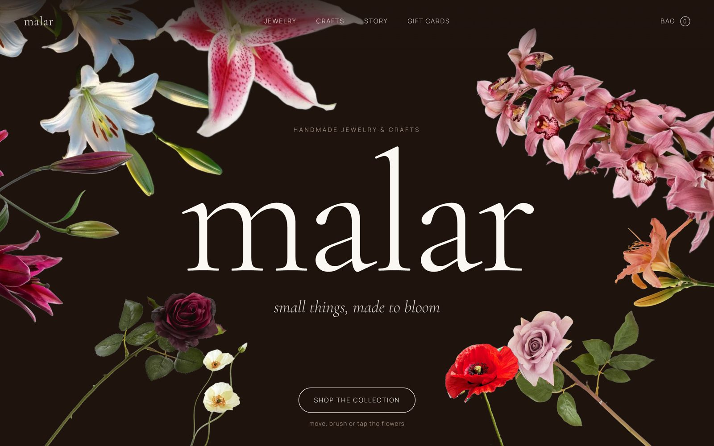

# malar

Website for **malar**, a small boutique of handmade jewelry and crafts. *Malar* means flower.



## Run it

It's a static site with no build step. Serve the folder with any local server:

```sh
python3 -m http.server 8000
# then open http://localhost:8000
```

(Opening `index.html` directly from disk won't load the flowers, because browsers block ES modules on `file://`.)

## What's here

| File | What it does |
| --- | --- |
| `index.html` | Page markup: hero, jewelry, crafts, story, gift cards, footer |
| `styles.css` | Look and feel: deep brown ground, Cormorant Garamond + Manrope |
| `flowers.js` | The hero garden. Each flower is a cut-out photo on a gently domed plane in Three.js. They grow in from the corners, tilt toward the pointer, wobble when brushed or tapped, and pull back as you scroll. |
| `flowers/` | The nine flower cut-outs (WebP, transparent background) |
| `vendor/` | Three.js r169, kept locally so no CDN is needed |

### Moving the flowers

Edit `LAYOUT` at the top of `flowers.js`. Each row is:

```
file, stem end (ax, ay), where the bloom lands (tx, ty), depth z, bloom position along the photo (0..1)
```

Positions are fractions of the hero (-1 to 1 on each axis), so the composition holds on any screen shape. Values past ±1 start the stem off-screen.

## Design

The page design (desktop and 390px phone) lives in Figma: https://www.figma.com/design/TwtSHtbBHt23KkkgcQgTEJ

## Notes

Product names, prices and story copy are placeholders. Check the rights to the flower photos before the site goes public.
